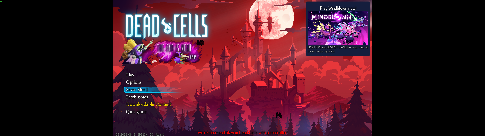
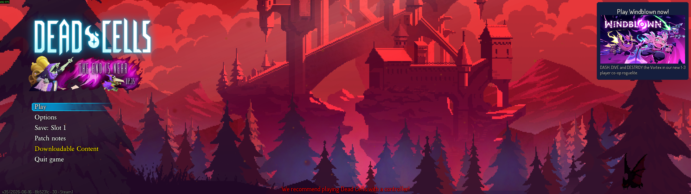
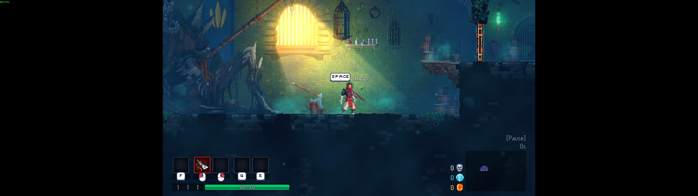
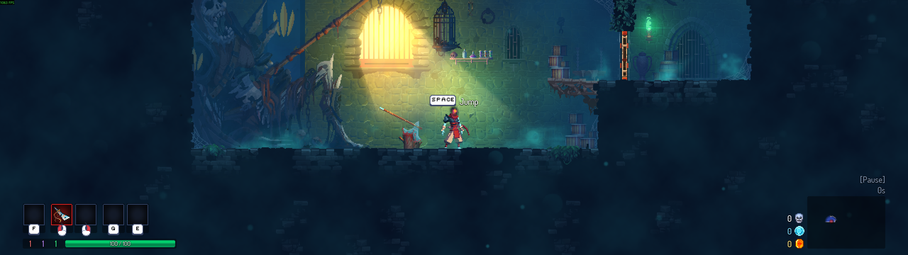

# Dead Cells ultrawide fix

Makes Dead Cells fill 21:9, 32:9 and other wide screens. You see more of the
level (Hor+), the HUD sits at the real screen edges, and nothing is stretched.
It changes **no game files**: a small standalone launcher adjusts one value
in the running game.

Tested on Steam v35 "The End Is Near" (2026-06-16, Steam build 23762174) at 5120x1440.

| Stock, 5120x1440 | With the fix |
|---|---|
|  |  |
|  |  |

## Why the game has black bars

Dead Cells runs on HashLink, and its compiled code is stored inside
`deadcells.exe`. On every resize, `Main.onResize` does this:

```
pixelScale   = max(1, 3 * min(W/1920, H/1080))      rounded down to 0.25
stage width  = min(pixelScale * Viewport.NATIVE_WIDTH,  W)
stage height = min(pixelScale * Viewport.NATIVE_HEIGHT, H)
```

Everything outside the stage is painted black. `NATIVE_WIDTH` is hardcoded to
**683** and `NATIVE_HEIGHT` to 400, which is about 16:9. At 5120x1440 the
pixelScale is 4, so the stage is 4 × 683 = 2732 px wide, and 1194 px on each
side stays black.

## What the fix does

It raises `NATIVE_WIDTH` so that the stage covers the whole monitor. At
5120x1440 the new value is 5120 / 4 = **1280**. The HUD, menus and parallax
backgrounds already lay themselves out from the stage size and
`NATIVE_WIDTH`, so they follow automatically. Vertical scale and pixel size
stay the same as stock, so sprites are never stretched.

The exe is protected by SteamStub DRM. Editing it on disk makes Steam refuse to
start it ("Application load error 3:0000065432"), so the launcher does not
touch it. Instead it:

1. starts the game through Steam;
2. waits for the game to set up its `Viewport` statics, which sit in memory as
   the int pair `683, 400`;
3. writes the new width into that single location, reads it back to confirm,
   and resizes the window by one pixel and back so the game re-lays-out at
   once.

If it does not find exactly one such pair, it refuses and changes nothing, so
an unsupported game version just runs stock.

## Use

The launcher writes into another program's memory, so only run it if you
trust it. The safest way is to read the source and build the exe yourself.
That takes a few minutes, and the only thing you take from this project is
source code you can read.

### Option 1: build it yourself (recommended)

You need:

- **Rust 1.88 or newer**, installed with [rustup](https://rustup.rs) using
  the default `x86_64-pc-windows-msvc` toolchain.
- **Microsoft C++ Build Tools** (the MSVC linker and Windows SDK). Get them
  from [Visual Studio Build Tools](https://visualstudio.microsoft.com/visual-cpp-build-tools/)
  and pick the **"Desktop development with C++"** workload. `rustup-init`
  offers to install this for you if it is missing.

Then download the source (`git clone`, or "Code" → "Download ZIP"), read it,
and build:

```
git clone https://github.com/prismicious/deadcells-ultrawide
cd deadcells-ultrawide
cargo test --release
cargo build --release
```

The exe lands in `target\release\deadcells-ultrawide.exe`. The build
downloads nothing else: the project has no third-party crates.

All the code is in `src/` and is short: `game.rs` finds and patches the
value, `win32.rs` holds the Windows API calls, and `main.rs` starts the game.

### Option 2: download the prebuilt exe

Each [release](https://github.com/prismicious/deadcells-ultrawide/releases)
also has a prebuilt `deadcells-ultrawide.exe`. Be clear about what you can and
cannot check:

- **The SHA-256 checksum** next to it proves the file you downloaded is the
  file that was published. It does not prove the file is safe.
- **The GitHub Actions log** linked from the release shows the exe was built
  by `.github/workflows/release.yml` from a specific commit in this
  repository, and that the tests passed. That ties the binary to the public
  source, but you still have to trust that source and this account.
- **The exe is not code-signed.** There is no verified publisher behind it.
  Windows SmartScreen may warn about it, and some antivirus tools flag any
  program that writes into another process's memory.

**VirusTotal report for v1.0.0:**
[View the executable's file report](https://www.virustotal.com/gui/file/b26c21cb58d1ed235d392c9f9bb96c210f3a363a34d429abf8f9950974482682).
It covers only the published `deadcells-ultrawide.exe` with SHA-256
`b26c21cb58d1ed235d392c9f9bb96c210f3a363a34d429abf8f9950974482682`,
not future releases or your own builds. The scan dated **2026-10-14 14:11 UTC**
reported **3 detections out of 71 engines**: SecureAge (API name APEX,
`Malicious`), McAfee Scanner (API name McAfeeD, `ti!B26C21CB58D1`), and
DeepInstinct (`MALICIOUS`). The other 68 reported
undetected; four additional engines did not support this file type.
This is **not a clean scan**. These detections have not been established as
false positives. A scan, including one with no detections, is not a safety
guarantee or proof of publisher trust. Results may change; check the report.

Treat those warnings as real. If you have not read the source and do not
trust this account, use Option 1 instead of overriding them.

### Running it

It is one standalone file with nothing to install: no Python, no .NET, no
runtime. It starts Dead Cells through Steam and widens it to fit your primary
monitor.

```
deadcells-ultrawide.exe                # launch via Steam, fit the primary monitor
deadcells-ultrawide.exe --width 1280   # pick the logical width yourself
deadcells-ultrawide.exe --attach       # fix a game that is already running
deadcells-ultrawide.exe --help
```

It opens no window of its own. Messages go to `deadcells-ultrawide.log` next
to the exe, or to the terminal when you start it from one.

### Run it from Steam's Play button (optional)

In Steam, open Dead Cells → Properties → Launch Options and enter:

```
"C:\path\to\deadcells-ultrawide.exe" %command%
```

Steam then starts the game through the launcher every time. If the fix cannot
be applied, the game still starts and runs stock.

## Undo

Start the game normally from Steam, or clear the launch options. Nothing on
disk was changed, so there is nothing to restore.

## After a game update

The fix finds the value afresh on every launch, so it keeps working as long as
the game still sets `NATIVE_WIDTH = 683, NATIVE_HEIGHT = 400`. If an update
changes that, the launcher logs that it found no match, and the game runs
stock.

## Side effects

- Steam achievements, cloud saves and save files are not touched. The game
  has no anti-cheat.
- The title screen's backdrop is drawn to cover the wider stage, so it shows a
  closer crop of the artwork.
- Full-screen panels such as the pause/equipment screen span the whole
  width. They are laid out for the wider stage, and the art inside them is
  not stretched (see `screenshots/after-pause-menu.png`).
- Small rooms and some cinematics were laid out for a 16:9 view. On a very
  wide screen you can see past their intended edges in places.

## Credits

The bytecode was explored with [hlbc](https://github.com/Gui-Yom/hlbc).
Earlier community work: czarman's 3DMigoto shader fix on PCGamingWiki (21:9).
This repository contains no game files.

## License

MIT, see [LICENSE](LICENSE).
